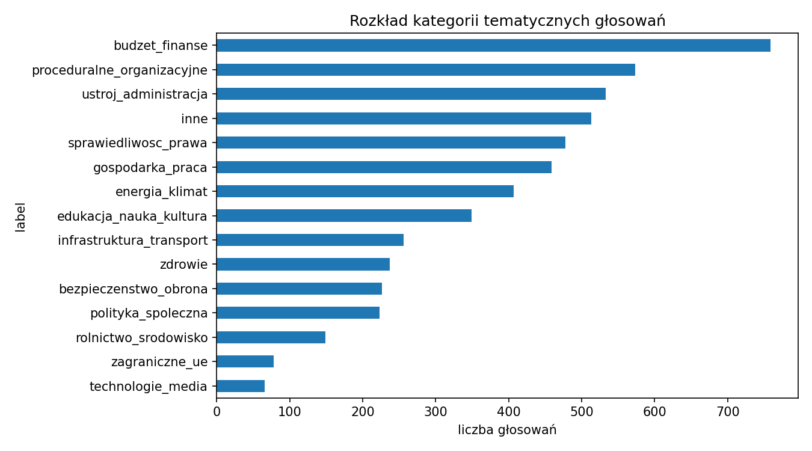
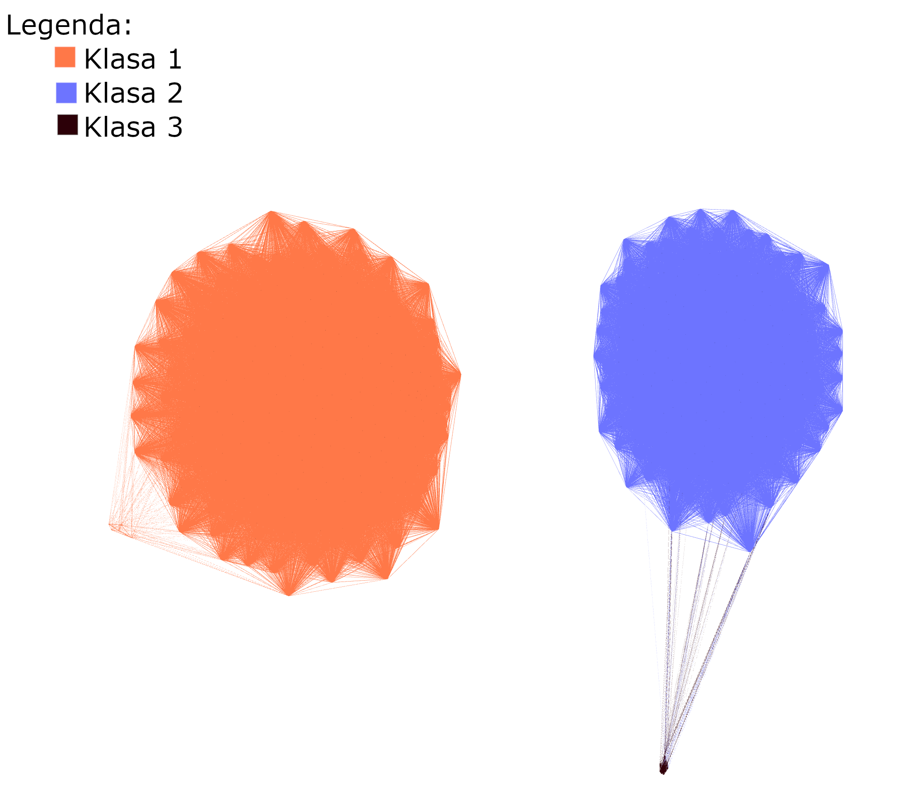

# sejm-network-analysis

Ilościowa analiza zachowań głosowań posłów w Sejmie RP X kadencji. Projekt łączy dane z API Sejmu, analizę sieci społecznych (SNA) i klasyfikację tematyczną głosowań metodami NLP. Docelowo ma odpowiedzieć na pytanie, czy relacje między posłami (dyscyplina klubowa, przekraczanie podziału rząd-opozycja) zależą od tematu głosowania.

[](https://www.python.org/)
[](https://networkx.org/)
[](https://spacy.io/)
[](https://api.sejm.gov.pl)

Status: etap 1 (analiza sieciowa) i moduł NLP (klasyfikacja tematów) są gotowe. Połączenie obu, czyli analiza dyscypliny w podziale na tematy, jest kolejnym etapem.

## Pytanie badawcze

1. Jak silna jest dyscyplina klubowa w Sejmie i jak dobrze podział na bloki polityczne wyjaśnia strukturę relacji między posłami?
2. Czy dyscyplina i przekraczanie linii podziału różnią się w zależności od tematu głosowania (budżet, zdrowie, bezpieczeństwo i inne)?

## Zawartość projektu

Projekt ma dwa komponenty, które można rozwijać niezależnie. Łączy je identyfikator głosowania (`glosowanie_id`).

1. Analiza sieciowa (etap 1). Sieć posłów zbudowana na podstawie zgodności głosowań, wykrywanie społeczności (Louvain), miary centralności. Wyniki w sekcji poniżej i w [docs/stage1_results.md](docs/stage1_results.md).
2. Moduł NLP (etap 2). Przypisanie każdemu głosowaniu kategorii tematycznej na podstawie tytułu, w pełni lokalnie, z użyciem spaCy i słownika reguł. Opis w sekcji "Moduł NLP".

## Przepływ danych

```text
[API Sejmu RP]
      |  notebook 01: pobieranie przyrostowe (JSON), posłowie, druki
      v
data/raw/term10/  ->  data/interim/votings_text.csv
      |
      |  notebook 03, część A: normalizacja tytułów, typ głosowania, reguły proceduralne
      v
unikalne punkty porządku obrad  ->  arkusz do ręcznego oznaczania (100 punktów)
      |
      |  notebook 03, część B: lematyzacja (spaCy), słownik, ocena na etykietach ręcznych
      v
data/interim/votings_labeled.csv   (kategoria tematyczna każdego głosowania)
```

## Moduł NLP: klasyfikacja tematów głosowań

### Zadanie

Dla każdego głosowania ustalić obszar polityki publicznej, którego dotyczy. Większość głosowań to poprawki i wnioski do jednej ustawy, więc tematem jest ustawa, a nie pojedyncza poprawka. Klasyfikacja działa dlatego na poziomie unikalnych punktów porządku obrad (po usunięciu numeru punktu, numerów druków i etapu czytania), a etykiety są potem przypisywane wszystkim głosowaniom z danego punktu. Dzięki temu poprawki do tej samej ustawy zawsze mają ten sam temat.

Dwie dodatkowe zmienne wyznaczane są regułami, bez klasyfikatora: typ głosowania (poprawka, wniosek mniejszości, wniosek formalny, głosowanie nad całością i inne) oraz etap czytania. Dyscyplina w głosowaniu nad poprawką i nad całością ustawy może się różnić, więc ta informacja jest potrzebna w dalszej analizie.

### Podejście

Reguły i słownik słów kluczowych na lematach z polskiego modelu spaCy (`pl_core_news_md`). Wybrałem je, bo działają w pełni lokalnie, są deterministyczne i powtarzalne, nic nie kosztują, a każdą decyzję klasyfikatora da się wyjaśnić wskazaniem słowa, które ją spowodowało. Procedura: spaCy zamienia tytuł na lematy, każde trafienie słowa kluczowego daje kategorii jeden punkt, wygrywa kategoria z największą liczbą punktów, a druga w kolejności jest etykietą dodatkową. Brak trafień oznacza kategorię `inne`. Słownik liczy około 300 słów kluczowych (początków lematów). Głosowania bez treści merytorycznej (nagłówki posiedzeń, zmiany w składach komisji, wnioski formalne bez przedmiotu) dostają kategorię `proceduralne_organizacyjne` z reguł i nie trafiają do klasyfikatora.

### Kategorie

| Kategoria | Zakres |
|---|---|
| energia_klimat | energetyka, ceny energii i paliw, polityka klimatyczna |
| zdrowie | ochrona zdrowia, leki, zdrowie publiczne |
| polityka_spoleczna | emerytury i renty, świadczenia, rodzina, niepełnosprawność |
| budzet_finanse | budżet, podatki, system finansowy, ubezpieczenia |
| gospodarka_praca | regulacje gospodarcze, przedsiębiorczość, prawo pracy, konsumenci |
| rolnictwo_srodowisko | rolnictwo, leśnictwo, wieś, środowisko, woda i odpady |
| edukacja_nauka_kultura | szkolnictwo, nauka, kultura, dziedzictwo, sport |
| sprawiedliwosc_prawa | sądy, prokuratura, prawo karne i cywilne, prawa obywatelskie |
| bezpieczenstwo_obrona | wojsko, służby, policja, straż graniczna, migracje |
| zagraniczne_ue | umowy międzynarodowe, Unia Europejska, stosunki zagraniczne |
| ustroj_administracja | ustrój państwa, wybory, samorząd, instytucje państwowe |
| infrastruktura_transport | transport, budownictwo, planowanie przestrzenne, mieszkalnictwo |
| technologie_media | cyfryzacja, telekomunikacja, media |
| inne | treść merytoryczna niepasująca do powyższych |
| proceduralne_organizacyjne | nadawane regułami, bez treści merytorycznej |

### Walidacja

Ze wszystkich unikalnych punktów wylosowano 100 (stałe ziarno losowania) i oznaczono ręcznie, podając kategorię główną i opcjonalnie dodatkową. Próbę podzielono na zbiór strojenia (40 punktów, na którym poprawiano słownik) i zbiór testowy (60 punktów). Do oceny trafiły 57 punktów testowych, bo trzy zostały w międzyczasie rozstrzygnięte regułami proceduralnymi. Miary: accuracy dla etykiety głównej, accuracy z uznaniem etykiety dodatkowej (wiele tytułów dotyczy dwóch obszarów) oraz kappa Cohena, czyli zgodność poprawiona o zgodność przypadkową.

### Wyniki na zbiorze testowym (n = 57)

| Miara | Wartość | Przedział ufności 95% |
|---|---|---|
| accuracy (etykieta główna) | 0,72 | 0,59 do 0,82 |
| accuracy z etykietą dodatkową | 0,86 | 0,75 do 0,93 |
| kappa Cohena | 0,69 | nie liczono |

Przedziały ufności to przedziały Wilsona dla odsetka trafień. Próba jest mała, więc przedziały są szerokie, a wynik należy czytać jako rząd wielkości, a nie dokładną wartość. Przy 15 kategoriach i regułowej metodzie traktuję to jako solidny punkt odniesienia dla późniejszych, bardziej zaawansowanych metod.

Rozkład kategorii w całym zbiorze: 5306 głosowań, w tym 573 głosowań proceduralnych.
Unikalne punkty do klasyfikacji: 1333



### Ograniczenia

1. Mała próba walidacyjna i jeden oceniający. Przedziały ufności są szerokie, a ręczne etykiety odzwierciedlają moje decyzje przy niejednoznacznych tytułach.
2. Słownik był poprawiany na zbiorze strojenia (40 punktów). Ocena końcowa nie jest w pełni niezależna, bo wynik na zbiorze testowym oglądałem wcześniej, zanim zakończyłem poprawianie słownika.
3. Metoda liczy słowa kluczowe i nie rozumie kontekstu. Nazwa instytucji w tytule (np. Krajowa Rada Radiofonii i Telewizji) może przeważyć nad tematem sprawy, a ustawy wielotematyczne dostają jedną etykietę główną.
4. Taksonomia nie ma osobnych kategorii na uchwały okolicznościowe i wnioski o uchylenie immunitetu. W etykietach ręcznych przyjęto konwencję: uchwały okolicznościowe jako kultura, immunitety jako sprawiedliwość. Inna konwencja zmieniłaby wyniki.
5. Słownik napisano dla X kadencji. Użycie go dla innych kadencji wymaga sprawdzenia, czy słownictwo tytułów się nie różni.

### Dalsze kroki

1. Porównanie z drugą metodą (model językowy lub lokalne embeddingi zdań) na tych samych etykietach ręcznych.
2. Druga ocena ręczna tych samych punktów po kilku dniach, żeby zmierzyć zgodność ocen jednego oceniającego.
3. Rozszerzenie taksonomii o kategorie z punktu 4 ograniczeń.
4. Połączenie etykiet z macierzą głosów posłów i analiza dyscypliny według tematów.

## Etap 1: analiza sieciowa (skrót)

Sieć posłów X kadencji zbudowana na posiedzeniach 20-35 (991 głosowań, 742 po filtrze kontrowersyjności): 461 węzłów, 48 358 krawędzi, modularność Louvaina Q = 0,477. Szczegóły i wnioski w [docs/stage1_results.md](docs/stage1_results.md). Gęstość wewnątrzklubowa przy progu zgodności 0,80 jest bliska 1,000 dla większości klubów, więc w kolejnych etapach planuję miary ciągłe (np. indeks Rice'a).

| Podział według klubów parlamentarnych | Detekcja społeczności (Louvain, Q = 0,477) |
|:---:|:---:|
|  |  |

## Struktura repozytorium

```text
sejm-network-analysis/
  notebook/
    01_data_collection.ipynb     pobieranie danych z API Sejmu
    03_nlp_rules_spacy.ipynb     moduł NLP: przygotowanie, klasyfikacja, ocena
    legacy/                      notebooki z etapu 1
  docs/                          wyniki etapu 1, opis metodologii
  results/
    gold_labels.csv              ręczne etykiety (złoty standard do oceny)
    rules_spacy_v2.json          słownik klasyfikatora z numerem wersji
  assets/                        wizualizacje
  data/                          dane (poza gitem, odtwarzane notebookiem 01)
```

## Uruchomienie

```bash
git clone https://github.com/Turski-P/sejm-network-analysis.git
cd sejm-network-analysis
pip install spacy pandas requests matplotlib
python -m spacy download pl_core_news_md
```

Kolejność pracy:

1. `notebook/01_data_collection.ipynb` pobiera dane z API do `data/raw/` i tworzy `data/interim/votings_text.csv`. Notebook można uruchamiać wielokrotnie, pobiera tylko nowe głosowania.
2. `notebook/03_nlp_rules_spacy.ipynb`, część A: przygotowanie tekstów i arkusz do oznaczania w `data/labeling/`. Po ręcznym oznaczeniu zapisz arkusz jako `results/gold_labels.csv`.
3. Ten sam notebook, część B: klasyfikator, ocena i zapis etykiet w `data/interim/votings_labeled.csv`.

Dane (`data/`) nie są wersjonowane w gicie. Ręczne etykiety i słownik w `results/` są wersjonowane, bo nie da się ich odtworzyć skryptem.

## Dane

Źródło: [API Sejmu RP](https://api.sejm.gov.pl), X kadencja, stan danych na listopad 2026 (5306 głosowań). Surowe odpowiedzi API są zapisywane w niezmienionej postaci, a przekształcenia dzieją się w kolejnych krokach.

## Autor i licencja

Autor: Przemek Turski ([Turski-P](https://github.com/Turski-P)). Licencja: do uzupełnienia.
